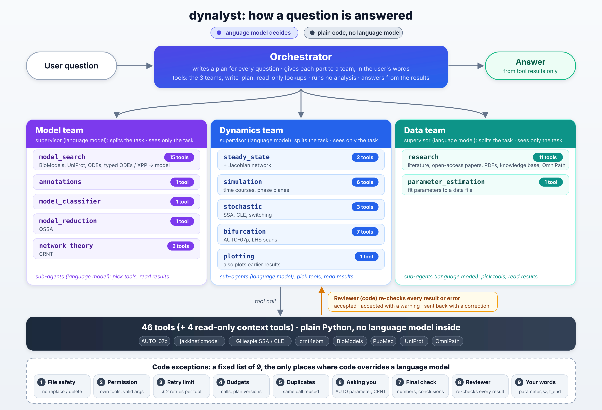
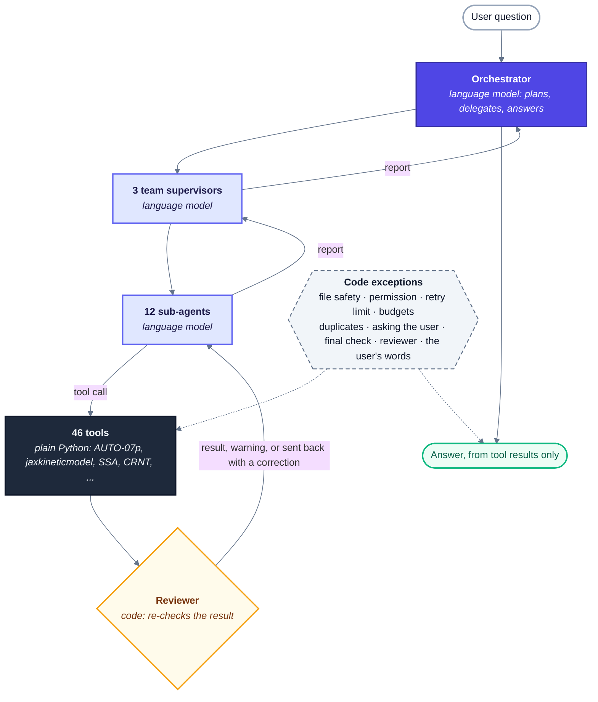

# dynalyst: a bifurcation-analysis agent for biochemical models

`dynalyst` answers plain-language questions about biochemical models by running real
numerical tools: AUTO-07p for bifurcation diagrams, jaxkineticmodel for simulation and
fitting, Gillespie SSA / CLE for stochastic dynamics, crnt4sbml for reaction network
theory, and BioModels, PubMed, UniProt and OmniPath for models and prior knowledge.

```text
"Where can Markevich2004 sit at rest, and are those states stable?"
"Bifurcation diagram of dx/dt = mu*x - x^3 in mu from -1 to 1"
"Scan 50 parameter sets of my_model.xml around their values and show which are bistable"
"Find the BioModels entry for Kholodenko 2000 and simulate it for 100 minutes"
```

Language models plan the work, choose the tools and read their results, errors included;
a short, fixed list of code rules keeps files safe, limits cost, re-checks every result
numerically, and checks that every number in the answer comes from a tool result.

---

## Contents

- [What it can do](#what-it-can-do)
- [Quick start](#quick-start)
- [How it works](#how-it-works)
- [What is verified](#what-is-verified)
- [The analyses](#the-analyses)
- [Configuration](#configuration)
- [Open and self-hosted models](#open-and-self-hosted-models)
- [Knowledge base (RAG)](#knowledge-base-rag)
- [Project layout](#project-layout)
- [Tests](#tests)
- [Known limitations](#known-limitations)
- [Citing](#citing)
- [Credits and licenses](#credits-and-licenses)

---

## What it can do

| Area | Examples |
|---|---|
| **Bifurcation analysis** | One-parameter AUTO-07p diagrams with folds (LP), branch points (BP) and Hopf points (HB, super- or subcritical); automatic choice of the continuation parameter and window; limit-cycle continuation from a Hopf point with cycle stability, period doublings (PD) and torus points (TR); folds of cycles when the user asks for them |
| **Parameter scans** | Latin-hypercube (LHS) scans that run a diagram per sample and classify each (bistable, branch point, Hopf, single fold, ultrasensitive, graded); goal-driven scans ("find bistability"); plain sweeps without continuation |
| **Steady states** | All steady states with their stability; the Jacobian at each as a signed interaction network with feedback loops and sensitivities |
| **Simulation** | Time courses, several initial conditions, phase planes, custom plots; SBML events and delays; stochastic simulation (Gillespie SSA, CLE) with noise statistics, distributions and switching between stable states, and explicit ODE-vs-stochastic comparisons |
| **Plots of earlier results** | Numbers earlier tools gave (for example fold values against a second parameter) plotted as they are, without a new simulation; numbers no result gave are refused |
| **Model structure** | Independent dimension after conservation laws (what dynamics it allows), timescale analysis, validated QSSA reduction exported as SBML |
| **Reaction network theory** | Deficiency theorems and searches for rate constants with several steady states (crnt4sbml); network drawings |
| **Parameter estimation** | Fitting chosen parameters to a time-course CSV from a Latin-hypercube design of start points, with an identifiability analysis |
| **Models and literature** | BioModels search and download, the models behind a paper (PDF, PubMed ID, DOI), PubMed and Europe PMC, UniProt, reading PDFs, mapping a paper's values onto a model, OmniPath network checks |
| **Inputs** | SBML files, BioModels IDs, XPPAUT `.ode` files, and ODEs typed straight into the request |

---

## Quick start

**Step-by-step installation for Linux (Ubuntu, Debian, Red Hat and others, with or without `sudo`), macOS and
Windows is in [`INSTALL.md`](INSTALL.md).** To rerun the prompts of the paper, open the notebooks in
[`notebooks/benchmarks/`](notebooks/benchmarks/) (see its `README.md`). The short version follows.

Run every command below from the repository root (the folder that holds `README.md`).

### 1. What you need

| | |
|---|---|
| **Python** | 3.11, in a conda environment ([Miniconda](https://docs.conda.io/en/latest/miniconda.html) or Anaconda) |
| **gfortran** | to build AUTO-07p once per machine (see [step 4](#4-build-auto-07p)) |
| **A language model** | an API key for a hosted model, or an open model you run yourself (see [step 6](#6-choose-a-language-model)). Not needed to install or to run the tests |
| **A GPU** | optional; only speeds up building the knowledge-base index |

### 2. Get the code

```bash
git clone https://github.com/dynalyst26/dynalyst.git dynalyst
cd dynalyst
```

or unzip the release archive and `cd` into the `dynalyst/` folder it contains.

### 3. Install

**Linux and macOS: one command**

```bash
bash setup_env.sh
```

It creates the conda environment `dynalyst` (Python 3.11) and installs, in order: PyTorch,
JAX 0.4.35, jaxkineticmodel from `vendor/jaxkineticmodel`, everything in `requirements.txt`,
crnt4sbml, and this project (`pip install -e .`). It then builds AUTO-07p (step 4) and runs a
few import checks. It takes a while; on a remote server, run it inside `tmux` or `screen`.
`ENV_NAME=myenv bash setup_env.sh` uses another environment name.

**Windows: the same steps by hand**, in an *Anaconda Prompt* (or any terminal where `conda`
works):

```bash
conda create -n dynalyst python=3.11 -y
conda activate dynalyst
pip install torch
pip install "jax==0.4.35"
pip install -e vendor/jaxkineticmodel
pip install -r requirements.txt
pip install --no-deps "crnt4sbml==0.0.15"
pip install -e .
python scripts/build_auto.py
```

(`setup_env.sh` also runs in Git Bash if `conda` works there.)

Two installs need care, on every OS:

- **crnt4sbml** goes in with `--no-deps`: its pinned dependencies (numpy 1.16, sympy 1.4, …)
  cannot coexist with JAX. It runs on current versions; `dynalyst` aliases the few names it needs.
- **JAX** is the CPU build, also on GPU machines: the agent's simulations are small, and the
  CUDA build of the pinned JAX 0.4.35 predates recent GPUs. `JAX_GPU=1 bash setup_env.sh`
  installs the CUDA build instead. On a GPU machine, match PyTorch's CUDA version to your driver
  (`setup_env.sh` uses `cu121`; see the top right of `nvidia-smi`).

The exact package versions of the Linux install used for every run in the paper are in
`env/requirements-lock.txt`, for when a newer release of a dependency breaks something.

**Minimal install.** The core (model reading, simulation, steady states, AUTO-07p
continuation, the agent and its checks) needs only the packages in `pyproject.toml`:

```bash
pip install -e .                 # core
python scripts/build_auto.py     # unpacks vendor/auto-07p.zip, builds AUTO-07p, checks it
```

The rest are extras: `pip install -e ".[providers]"` (Anthropic, Ollama, Gemini models),
`".[jkm]"` (jaxkineticmodel tools; then `pip install -e vendor/jaxkineticmodel --no-deps`),
`".[rag]"` (knowledge base, PDF reading, reports), `".[notebook]"`, `".[test]"`, or
`".[all]"` for everything used in the paper. Reaction network theory needs
`pip install --no-deps "crnt4sbml==0.0.15"`. A tool whose extra is missing says which
package to install.

### 4. Build AUTO-07p

`setup_env.sh` and the Windows steps above already do this. To build or check it yourself:

```bash
python scripts/build_auto.py           # build, then check (about a minute)
python scripts/build_auto.py --check   # only the check
python scripts/build_auto.py --force   # rebuild
```

It needs only `gfortran` on PATH; AUTO's own `configure` / `make` are not used.

| OS | Getting gfortran |
|---|---|
| Windows | `winget install BrechtSanders.WinLibs.POSIX.UCRT`, or `conda install -c conda-forge m2w64-gcc-fortran` |
| Linux | `sudo apt-get install -y gfortran`, or `conda install -c conda-forge gfortran` |
| macOS | `brew install gcc` (needs `xcode-select --install`), or `conda install -c conda-forge gfortran` |

The library goes to `vendor/auto-07p/lib/<OS>-<CPU>-gfortran<version>/` (for example
`win32-amd64-gfortran16`), so one copy of the project, synced between machines, works on each
once it has been built there. The check continues dx/dt = p + x − x³ and must find its two folds
at p = ∓0.3849. Set `AUTO_DIR` to use an existing AUTO installation instead.

`source scripts/activate.sh` (Linux, macOS, Git Bash) is optional: it only puts AUTO's own command-line
tools on PATH. The Python code finds AUTO by itself.

### 5. Check the install

```bash
python scripts/build_auto.py --check         # AUTO-07p works
python -m pytest -q -m "not auto"            # all but the 39 AUTO integration tests
python -m pytest -q                          # the full suite (about 780 tests, 1–2 hours)
```

No test calls a language model, so no API key is needed.

**If `import jax` fails** with `TypeError: expected str, bytes or os.PathLike object, not
NoneType`, a leftover `nvidia/cuda_nvcc` folder is in the environment. Set `CUDA_ROOT` for the
environment and reactivate it (`setup_env.sh` does this for the CPU build):

```bash
conda env config vars set CUDA_ROOT="$CONDA_PREFIX"     # Linux, macOS, Git Bash
conda env config vars set CUDA_ROOT=%CONDA_PREFIX%      # Windows Anaconda Prompt
conda deactivate && conda activate dynalyst
```

### 6. Choose a language model

In the notebook, pick the model from a list (step 7). From Python or the terminal, set it in
the environment:

```bash
# Linux, macOS, Git Bash
export DYNALYST_MODEL=openai:gpt-4o-mini        # the default
export OPENAI_API_KEY=<your key>
```

```powershell
# Windows PowerShell
$env:DYNALYST_MODEL = "openai:gpt-4o-mini"
$env:OPENAI_API_KEY = "<your key>"
```

`DYNALYST_MODEL` takes any LangChain `provider:model` string, with that provider's key:
`anthropic:<model>` (`ANTHROPIC_API_KEY`), `google_genai:<model>` (`GOOGLE_API_KEY`),
`ollama:<model>` (no key). **Free option:** NVIDIA's hosted Nemotron models need only a free key
from build.nvidia.com; see [Open and self-hosted models](#open-and-self-hosted-models) for those,
for vLLM and for Ollama. A model must handle tool calling well; small models (about 4B) make
mistakes.

### 7. Ask a question

**Notebook** (`notebooks/dynalyst.ipynb`, start it with `jupyter lab`). Its first cell shows a
**model list**: choose a model, paste its API key when asked (only models that need one ask; a
key already set in the environment is used when the box is left blank), and press *Use this
model*. The list has the free NVIDIA-hosted Nemotron models, OpenAI, Anthropic and Google
(Gemini) models, a local Ollama model, your own vLLM server and any other LangChain model. The
key stays in the notebook's memory: nothing is saved to disk, and other programs are not
affected. Then use the chat box or `ask(...)`. The notebook also shows model upload, one example
per capability, and how to inspect what a run did. `notebooks/tools/` has one notebook per
capability that calls the tools directly, without a language model.

**Python**

```python
from dynalyst.notebook import ask                  # shows plots and tables inline in Jupyter
ask("Run a bifurcation analysis of Markevich2004 in k2cat")

from dynalyst.agents.unified_agent import ask, run
answer = ask("Find the steady states of Markevich2004")   # the answer text
rec = run("Find the steady states of Markevich2004")      # the full run record
rec.plan_versions, rec.steps, rec.final_check
```

**A JupyterLab cell, as a chat** (`scripts/ask_dynalyst.py`): the answer and every new plot
appear in the cell, and each plot is also saved under `outputs/ask/<time>/`.

```python
import sys; sys.path.insert(0, "scripts")
from ask_dynalyst import ask, new_chat
ask("Find the steady states of Markevich2004")
ask("yes")        # answer a question the agent asked
new_chat()        # start a fresh conversation
```

**Terminal**: `python -m dynalyst.cli` (`--model provider:model` to switch models).

Everything the tools write (plots, tables, run records) goes to `outputs/`.

---

## How it works

The agent lives in `dynalyst/orchestration/`; `dynalyst/agents/unified_agent.py` is its
entry point. **Language models make every decision about the request; code adds only a
short, fixed list of exceptions** for what a prompt cannot guarantee (safety, cost, results
that are numerically right, and an answer whose numbers are real).

### The picture



The same, as a flowchart:



1. The **orchestrator** reads the question, passes each part to a team in the user's own
   words, reads what comes back, and answers. It calls no analysis tool itself. For every
   question it first writes a plan (`write_plan`): the question broken into its parts, one
   part being a one-step plan; it writes it again when a result changes what is needed. There is no separate planner.
2. A **team supervisor** hands the parts of its task to its sub-agents; independent parts
   run in parallel.
3. A **sub-agent** looks the model up (read-only context tools), calls its own
   analysis tools, reads their results, and reports.
4. A **tool** is plain Python with no language model inside. It runs, or returns an error
   that says why (a parameter the model does not have, a file name that is taken). The
   error goes back up as information: the sub-agent can correct its call, and the
   orchestrator can choose another route or tell the user.
5. The **reviewer** re-checks every result from the model's own equations (see below). A
   result that fails goes back to the sub-agent with a correction (at most 3 times per
   task); a usable result with a caveat carries a warning up to the answer. It then reads
   the written answer against the results (one language-model call) and lists claims no
   result supports, such as a ranking the numbers do not give; the orchestrator then gets one
   more round with its tools to run what is missing or correct those claims.
6. The **final check** makes sure every number, model ID and paper title in the answer
   appears in a tool result of this request, and that its conclusions are ones an analysis
   reached.

### Who decides what

| Component | Language model? | What it decides | File |
|---|---|---|---|
| Orchestrator | yes (≤ 14 calls) | which team gets which part, a plan for every question (its parts), which parts run in parallel, clarifying questions, the answer; its tools are the 3 teams, `write_plan`, read-only lookups: two lists (local models, PDFs), `model_parameters` (a model's parameters and their part in the rate laws, to see which ones a user's description fits), `inspect_model` and `inspect_dataset` | `agent.py` |
| Team supervisors | yes (≤ 6 calls per task) | how to split a task among the team's sub-agents | `teams.py` |
| Sub-agents | yes (≤ 6 calls per task) | which of their tools to call, with which arguments; what to do after an error | `subagents.py` |
| Analysis tools | no | the computation, and errors for inputs that cannot work | `analysis/`, `regime/` |
| Guard | no | permission, retry limit, duplicate calls | `guard.py` |
| File safety | no | no file is replaced, deleted, or written outside its folders | `safety.py` |
| Tool input checks | no | a parameter the model does not have; values that change nothing | `inputs.py` |
| Asking the user | no (asks the user) | in a chat, the run pauses before AUTO-07p when the user's own words name no parameter of the model and when a CRNT search runs long | `approval.py` |
| Reviewer | no for results; yes (1 call) for the answer | whether a result is numerically sound: accept, accept with warnings, or send back with a correction; which claims of the answer no result supports | `reviewer.py`, `agent.py` (`_review_answer`) |
| Final check | no | the answer's numbers, IDs and titles come from tool results, and its conclusions from analyses that reached them | `final_check.py` |
| Follow-ups | no | the "What next?" list, from what the run found | `next_steps.py` |

### The code exceptions (a fixed list of 9)

| # | Exception | Why it is code, not a prompt |
|---|---|---|
| 1 | **File safety**: a name for a new file is a plain name (no folder, no `..`); an existing file is never replaced (`overwrite` is refused); new model files go only into `data/sbml_models`; a CRNT job id must be one the tool made, so it cannot point a delete at another folder | Safety: a prompt can be ignored |
| 2 | **Permission**: a sub-agent calls only its own tools, with arguments that fit the schema | A wrong tool must not run |
| 3 | **Retry limit**: a tool that failed is retried at most `MAX_TOOL_RETRIES` (2) times per request, and the same failed call never | Stops loops |
| 4 | **Budgets**: model calls per role, analyses per task, tasks per sub-agent, plan versions | Cost; stops loops |
| 5 | **Duplicates**: the same call in one request reuses its result | Cost: AUTO-07p runs are slow |
| 6 | **Asking the user** (chat only), each time keeping what already ran: before a one-diagram AUTO-07p run when the user's own words name none of the model's parameters, even if the agent filled one in (ranked candidates, the user picks); before an LHS scan whose call names no parameter; when a CRNT search is still running after `CRNT_ASK_SECONDS`, whether to wait for it (then AUTO-07p checks its first candidate set) or stop it and draw the diagram | Long, expensive runs are the user's choice |
| 7 | **Final check**: every number, model ID and paper title in the answer appears in a tool result. The same holds for a plot of earlier results: a `custom_plot` call with `series` runs only if every plotted number appears in the request, the chat or an earlier result of this request. Conclusions must be ones an analysis reached: no behaviour called absent when the methods that ran failed or did not apply, no bistability from CRNT candidates alone, no bifurcation point that no analysis found, and no fold the diagram found left out. One rewrite of the paragraphs concerned, then removal or a note | The answer must come from the tools |
| 8 | **Reviewer**: every result is re-checked independently of the tool that made it: reported LP / BP / HB points must be steady states of the model's own equations with the right eigenvalues (after removing conservation laws); steady states are re-solved and their stability recomputed; simulations must be finite, non-negative, keep conserved totals and move when dy/dt ≠ 0; fits must lower the loss and not sit on a search bound; AUTO runs that stopped abnormally, scans with many failed samples and missing plots are flagged. A fixable failure goes back to the sub-agent with a correction (`REVIEWER_MAX_REPLANS` = 3); the rest become warnings in the answer | A language model cannot verify numerical results reliably |
| 9 | **The user's own words**, read for four things only: whether they name a parameter of the model (exception 6); whether they ask for folds of cycles (only then are they reported); the system size omega and the end time t_end of a stochastic run (a value the words do not contain is dropped, so the defaults omega = 1 and t_end = 100 apply); and, in the other direction, a steady state the agent retyped into `initial_conditions` of a stochastic run is replaced by the exact state `find_steady_states` computed in the same request | These are the user's choices, or numbers a language model would round on the way |

Apart from exception 9, no code reads the user's request: the guard never sees it, and there
are no keyword rules for routing or planning.

### What each role sees

| Role | Sees |
|---|---|
| Orchestrator | the user's message, the last 10 messages of the chat, and the **session facts** (models and results of earlier questions), to use only when the user refers back |
| Team supervisor | only the orchestrator's task |
| Sub-agent | only its supervisor's task, plus lessons for its tools |
| Guard | only the call (sub-agent, tool, arguments) |
| Reviewer | only the call and its result (and the model file, to re-derive the result); for the answer: the question, this request's results and the answer |

Because a sub-agent sees only its task, it cannot pick up a model from an earlier question:
the orchestrator must name the model in every task. **Clear chat** also clears the session
facts (`outputs/session_state.json`).

**Lessons** (`lessons.py`): a call that failed and then succeeded with other arguments is
saved as data (tool, kind of problem, which argument names changed; never a model, parameter
name or value) and shown to later sub-agents using that tool. `DYNALYST_LESSONS=0` turns it off.

### The prompts

Every prompt has the same parts: **who I am, scope** (with a fixed reply for what is out of
scope), **tools** (when to call each), **input, rules** (at most 5), **output** (an exact
format) and **one worked example**. Read them in `agent.py` (`ORCHESTRATOR_PROMPT`),
`teams.py` (`Team.prompt`) and `subagents.py` (`SubAgent.prompt`); the bifurcation
sub-agent also gets a glossary and worked examples for range requests (`understanding.py`).

Out of scope, the orchestrator answers only "This is outside what I can help with". A
model-independent question (what a Hopf bifurcation is) may be answered from established
knowledge; anything about a particular model must come from an analysis of that model, and
the answer review flags it otherwise, however it is labelled. Everything else in an answer
cites the plan step it came from.

### Teams, sub-agents and tools

| Team | Sub-agent | Tool | What it does |
|---|---|---|---|
| `model_team` | `model_search` | `search_biomodels` | search BioModels by topic, name or author |
| | | `get_biomodels_info` | one BioModels entry: description, curation, article |
| | | `fetch_biomodels_model` | download an entry's SBML into the model folder |
| | | `find_biomodels_by_paper` | the entries of a paper named by author and year |
| | | `find_models_for_article` | the entries built from an uploaded PDF |
| | | `find_models_for_pubmed` | the entries built from a PubMed ID or DOI |
| | | `get_uniprot_entry` | one UniProt protein by accession |
| | | `search_uniprot` | search UniProt by protein or gene name |
| | | `model_proteins` | which proteins a model's species are |
| | | `add_model_to_knowledge_base` | add a model to the knowledge base |
| | | `save_sbml` | save a changed copy of a model under a new name |
| | | `get_odes` | a model's ODEs and values, as written in the file |
| | | `odes_to_sbml`, `xpp_to_sbml`, `xpp_text_to_sbml` | typed equations or an XPP file turned into a model file |
| | `annotations` | `get_annotations` | the annotations stored in an SBML file |
| | `model_classifier` | `classify_model` | dimension, conservation laws, timescale gaps |
| | `model_reduction` | `reduce_model` | conservation-law elimination and validated QSSA |
| | `network_theory` | `crnt_bistability` | CRNT: can the network have several steady states |
| | | `draw_reaction_network` | draw the reaction network |
| `dynamics_team` | `steady_state` | `find_steady_states` | all steady states and their stability |
| | | `jacobian_network` | Jacobian, signed interaction network, feedback loops, sensitivities |
| | `simulation` | `simulate_model` | one deterministic time course |
| | | `compare_initial_conditions` | several starting points on one plot |
| | | `custom_plot` | a time-course plot with chosen species, windows, log axes |
| | | `plot_phase_plane` | one species against another |
| | | `plot_rate_of_change` | net production and consumption over time |
| | | `find_steady_states` | shared with `steady_state` |
| | `stochastic` | `stochastic_simulation` | Gillespie SSA (CLE, tau-leaping on request); switching events between stable states, with a plot |
| | | `compare_simulations` | stochastic vs deterministic on the same inputs |
| | | `propensity_table` | reaction channels and propensities, without simulating |
| | `bifurcation` | `run_bifurcation_analysis` | one AUTO-07p diagram: folds, branch points, Hopf points |
| | | `run_auto_problem` | AUTO-07p on typed maps, boundary value problems, optimization, orbits from data, waves |
| | | `generic_bifurcation_model` | a textbook example of a bifurcation type |
| | | `lhs_bifurcation_scan` | many sampled parameter sets, a diagram each, classified |
| | | `categorized_lhs_scan` | the same, one panel and file per category |
| | | `propose_bifurcation_candidates` | which parameters could give bistability or oscillations |
| | | `find_steady_states` | shared with `steady_state`, to reach branches a diagram did not |
| | `plotting` | `custom_plot` | a time-course plot with chosen species, windows, log axes; or, with `series`, numbers earlier results gave, plotted without simulating |
| `data_team` | `research` | `search_literature` | search papers (Europe PMC, PubMed) |
| | | `get_pubmed_article` | one article: title, authors, abstract |
| | | `fetch_open_access_paper` | download an open-access article and its supplements (PubMed Central) into `data/papers/` |
| | | `find_models_for_pubmed` | a paper's BioModels entries |
| | | `get_biomodels_info` | the paper behind a BioModels entry |
| | | `read_pdf` | the text of an uploaded PDF |
| | | `retrieve_knowledge` | search the knowledge base |
| | | `index_pdf` | add a PDF to the knowledge base |
| | | `map_paper_to_model` | a paper's parameter values next to a model's |
| | | `omnipath_network_check` | which interactions OmniPath supports, what the model lacks |
| | | `list_available_pdfs` | the uploaded PDFs |
| | `parameter_estimation` | `estimate_parameters` | fit parameters to measured data in a file |

- **The orchestrator runs no analysis itself.** Its only tools besides the teams and `write_plan` are
  read-only: `list_available_models`, `list_available_pdfs`, `model_parameters` (each
  parameter's value and its part in each rate law, read from the model file, so the
  orchestrator can tell when a description such as "the catalytic rate" fits several
  parameters and ask which), `inspect_model` (species, equations, reactions) and
  `inspect_dataset` (a data file's columns). Tools that write files stay with sub-agents,
  so every write goes through the guard and the reviewer. A model's ODEs (`get_odes`) and turning typed
  equations or XPP files into a model file (`odes_to_sbml`, `xpp_to_sbml`, `xpp_text_to_sbml`)
  belong to `model_search`; the list of uploaded PDFs (`list_available_pdfs`) to `research`.
- **Context tools** (every sub-agent, read-only): `inspect_model`, `list_available_models`,
  `get_model_odes`, `inspect_dataset`.

### Parallel execution

Delegations issued in the same turn, by the orchestrator or a team supervisor, run
concurrently (`MAX_PARALLEL` = 4). Network look-ups (BioModels, UniProt, Europe PMC) run
concurrently too; every other tool holds one execution lock, because plotting uses
matplotlib's global state and the AUTO pipeline changes the working directory.

### Run records

Every request's record is saved to `outputs/runs/<timestamp>.json`: every plan version with
its reason, every tool call with its arguments, result or error, the team traces, where an
exception stepped in, the final check, and model calls and tokens per role.

```bash
python scripts/inspect_run.py              # one run: plan versions, tool calls, exceptions
python scripts/summarize_runs.py           # many runs: model calls, tokens, time
```

---

## What is verified

Each claim an answer makes is checked by code, by a language model, or not at all:

| Claim in an answer | Verified by | Not verified |
|---|---|---|
| Steady state and its stability | Re-solved on the model's equations; eigenvalues recomputed (code) | That every steady state was found |
| Fold (LP) | Fold equations solved by Newton's method; one real eigenvalue crosses zero (code) | -- |
| Hopf point | A purely imaginary pair at the reported value (code) | Criticality (AUTO-07p's first Lyapunov coefficient, not recomputed) |
| Branch point | A zero eigenvalue (code) | Exact location (taken from AUTO-07p) |
| Branch coverage | Multi-start search at six parameter values; completeness check (code) | Branches with no steady state at those values |
| Simulation | Finite values, non-negative where required, conservation laws held (code) | That the run was long enough, beyond the settling check |
| Parameter estimates | Loss decreased; values stuck at a bound flagged (code) | Identifiability (reported by the tool, not checked); that the model is the right one for the data |
| Numbers, models, paper titles in the answer | Must appear in a tool result (final check, code) | -- |
| Interpretation of a result | Answer review (one language-model call) | Biological correctness of the interpretation |
| Mechanistic conclusions | -- | Not verified |

The reviewer checks that the numbers are right, not that the conclusion drawn from them is
the right scientific conclusion.

## The analyses

### Bifurcation analysis (AUTO-07p)

`run_bifurcation_analysis` works on any SBML, XPP or typed-ODE model:

1. The model is integrated to where it settles, and continuation starts from that state.
2. **Continuation parameter.** A named parameter or an XPP `@` hint always wins. In a chat,
   when the user's own words name no parameter, the ranked candidates are shown first and the
   user picks one (exception 6). Otherwise
   an eigenvalue screen (`analysis/parameter_screen.py`) follows the settled equilibrium a
   decade either side of each parameter's value and watches for fold, branch-point or Hopf
   crossings; the closest are tried first. The screen confirms a lost equilibrium before
   calling it a fold, and ranks a state that runs away without bound last.
3. **Parameters are discovered, never guessed.** Every tunable quantity counts: global
   parameters, species the model holds fixed, and constants local to a rate law (named
   `<reaction>_<name>`). A parameter the model lacks is rejected before anything runs.
4. **Window.** A range from the user or the XPP file is used as is. Otherwise a decade either
   side of the value, widened to three and five decades if nothing is found.
5. **Labelling** (`regime/taxonomy.classify_diagram`): *bistable* means two stable steady
   states coexist at one parameter value (reported with where); two folds that enclose no
   bistable window are a `single_fold`.
6. **Limit cycles** (always, in the same run, unless the call sets `cycles=false`): the cycles born at
   each Hopf point are continued with their period, amplitude and stability (Floquet
   multipliers), period doublings (PD, with the doubled branch) and torus points (TR). AUTO
   always detects folds of cycles; they are labelled and listed only when the user asks for
   them (`cycle_folds=true`, set from the user's words). Two Hopf points joined by one cycle
   branch are reported once.
7. **Scope.** One continuation parameter only: two-parameter curves, homoclinic and
   fixed-period continuation are not part of the agent. The two-parameter Hopf run that reads
   the first Lyapunov coefficient (super- or subcritical) is kept internally.

**Stochastic runs: system size and end time.** omega (molecules per concentration unit) is 1
unless the user gives one, and t_end is 100 unless the user gives one; a value the user gives is
used exactly, and the agent never chooses or changes either (exception 9). At omega = 1 a species
below about one concentration unit has almost no molecules: the result then carries a few-molecules
warning, and omega is not changed. Each omega gets one run and at most one retry per start state
and parameter values (the guard). A run that stops early reports `projected_full_run`, an
approximate time from its own event rate. After 10 s a run projects its full time, and at three
call limits or more it stops and keeps what ran: insufficient evidence, not a negative result.
`ssa_method="exact"` runs on. Every SSA call also runs the ODE internally (30 s limit, reported in
`ode_reference`) for the event estimate and the periods. Rate laws that are not elementary
reactions are named in `approximate_propensities`. To test bistability under noise,
`compare_simulations` with `start_in_each_state` starts runs in each stable ODE state; a start
retyped from `find_steady_states` is replaced by its exact values.

**Branches the start does not reach.** Continuation follows only the branches connected to its
start, so after the first run `find_steady_states` is run at a few values of the parameter
inside the range: the model's own value plus log-spaced values across the range, each sign
apart (an LHS sample uses four evenly spaced values unless `log_probes` is set). Every steady
state that lies on none of the branches followed so far is continued from in both directions
(at most 4 such starts), its branches are added to the diagram, and the result says where they
started ("Also followed: …"). A branch with no steady state at any of these values can still be
missed; it is reached by hand with `find_steady_states` (`param_name`, `param_min`,
`param_max`), then this tool with `fixed_params` and `initial_conditions`. Cycles with no link
to a Hopf point are not searched for; a user can start one from data with `run_auto_problem`
(kind `orbit`).

A continuation that uses all its steps is run again with a larger step, sized by the state as
well as the range. If it still does not cover the range and finds nothing, the label is
`incomplete`, in diagrams and LHS scans: no verdict on that range. A survey is offered the same
candidates as a diagram; the one chosen is followed along its range and not sampled.

A cycle branch can leave the requested range and come back. Its stretches are cut to the range,
and `branch_in_order` lists the whole curve in AUTO's order, so its parts stay connected.

The limit of diagrams per parameter in one request counts each start state apart, so a diagram
from a state `find_steady_states` found is not a repeat.

AUTO code generation maps states to `U(i)` and parameters to `PAR(i)` (`dynalyst/fortran.py`),
so model names that Fortran cannot take are never a problem; when a Jacobian entry cannot
be written symbolically, AUTO differentiates numerically.

### LHS parameter scans

`lhs_bifurcation_scan` and `categorized_lhs_scan` sample every parameter the model's
equations use around its baseline, run the main AUTO runner per sample (no cycles, no plot of
its own), and produce an overlay
plot, a summary CSV and Excel output. The `model` argument is required: no scan runs on a
silent default.

- **Conservation laws** are eliminated first; a conserved total would otherwise make the
  Jacobian singular everywhere.
- **One range layer** (`regime/range_spec.py`). However the request is phrased, it becomes
  final per-parameter bounds before sampling. Per parameter, first match wins: `fixed_params`
  → `vary_only` → exact bounds → that parameter's `param_windows` entry (`rel`, `fold`,
  `offset`) → the global window → the default, a fold of 2 around the baseline.
  Contradictions are reported, not resolved silently.
- **Categories** (`regime/taxonomy.py`): every sample gets its features and one primary
  category: `bistable`, `branch_point`, `hopf`, `single_fold`, then `ultrasensitive` /
  `graded` (Goldbeter–Koshland response ratio) or `no_bifurcation`, and `failed`.
  `separate=true` or `categorized_lhs_scan` adds one panel and one Excel file per category.
- **Goals** (`regime/lhs_goals.py`): `goal="bistability"`, `"branch point"`, `"hopf"` or
  `"ultrasensitivity"` sets a near-baseline default window, runs the unperturbed baseline as a
  control, and ends the report with what was found, what was not, and the exact argument that
  would widen or narrow the search. It never widens or narrows by itself.
- **Time-dependent inputs.** A stimulus defined through SBML's `time` symbol is frozen into a
  constant parameter at its long-time value, so the model has steady states and the input can
  be continued, sampled or set. Every result says what was frozen and at which value.

### Steady states and the Jacobian network

`find_steady_states` finds all steady states of a model of any dimension and classifies their
stability. `jacobian_network` reads the Jacobian at each steady state as a signed interaction
network (who activates or inhibits whom), with feedback loops and sensitivities.

### Simulation: deterministic and stochastic

- **Deterministic** (`simulation` sub-agent): time courses, several initial conditions, phase
  planes, rates of change, and custom plots (`custom_plot`: chosen species against time or
  each other, overlaid conditions, time windows, log axes). SBML events and delays are handled
  by `analysis/hybrid_sim.py`.
- **Plots of earlier results** (`plotting` sub-agent): `custom_plot` with `series` (a list of
  `{label, x, y}`, plus `x_label` / `y_label`) plots numbers that earlier tools gave, such as the
  two fold values of several diagrams against a second parameter, without simulating anything.
  A call is refused before it runs if a plotted number appears in no earlier result, the request
  or the chat (exception 7). Without `series`, `custom_plot` simulates exactly as before.
- **Stochastic** (`stochastic` sub-agent): `stochastic_simulation` runs Gillespie SSA by
  default and CLE only when asked, reporting molecule counts, noise statistics and empirical
  distributions; its only ODE run is the internal reference (`ode_reference`), never the
  result. Every jump between stable states in the recorded runs is found
  (`analysis/stochastic_switching.py`; the states are the peaks of the distribution, or the
  ODE's stable steady states when it has only one peak): `switching_events` gives how many jumps, up and
  down, and each run's first-jump time, and `switching_plot_path` shows one run with its jumps
  marked and zooms on up to three of them (re-run on a fine time grid from just before a jump
  when the recorded grid is too coarse). A run that switched is reported as bistable even if
  the pooled distribution shows one peak. `compare_simulations` is the explicit
  ODE-vs-stochastic comparison on the same model, parameters and initial conditions.
  `propensity_table` writes the model as reactions with their propensities (at a given state
  too: `values_at_state`). Long SSA runs switch to a compiled JAX engine when the numpy engine
  would exceed its time budget.

Models whose fluxes are SBML assignment rules are simulated through a converted copy
(`analysis/jaxkm_compat.py`), because jaxkineticmodel otherwise treats those fluxes as zero.

### Model structure and reduction

- `classify_model`: state variables, conservation laws, the independent dimension
  (1D / 2D / 3D+) and what it allows (no Hopf in 1D, no chaos in 2D), and whether a
  timescale gap justifies a QSSA.
- `reduce_model`: exact conservation-law elimination; timescales from Jacobian eigenvalues
  along the trajectory; a QSSA only when the same fast/slow split holds with a gap of at
  least 10× over at least 60% of the trajectory. The fast equations are solved in closed
  form where possible; the reduced model is validated against the full one (accurate at
  ≤ 5% deviation) and exported as `data/sbml_models/<model>_reduced.xml`. A reduction that is
  not accurate is reported as such, never presented as a replacement.

The agent reduces only when asked or when the user agrees to the suggested follow-up.

### Reaction network theory (crnt4sbml)

`crnt_bistability` answers "can this network have several steady states for some rate
constants?":

1. The model's equations are turned into an explicit mass-action network
   (`analysis/crnt_network.py`); species removed by hand through a conservation law are
   restored. Non-mass-action models are reported as such, naming the term.
2. crnt4sbml reports deficiency, linkage classes, weak reversibility and conservation laws,
   and checks the deficiency zero / one theorems.
3. Otherwise it searches for rate constants with several steady states, near the model's own
   values first. Each set found is saved as SBML.
4. Follow-ups (an AUTO diagram of a set, an LHS scan, the network drawing, the Jacobian
   network) are offered, never run automatically. The search runs in a separate process
   with a time limit (`CRNT_MAX_SECONDS`).

### Parameter estimation

`estimate_parameters` runs jaxkineticmodel's own `Trainer` once per start point of a
Latin-hypercube design (log-uniform by default, seedable; bounds nominal × [0.1, 10] unless
given). Only the parameters you name are fitted. The multi-start results are then analysed:
a parameter is **identifiable** when all good fits agree within 1.2×; otherwise it is
reported as not identifiable from these data, and parameters that trade off
(|correlation of log values| ≥ 0.95) are reported as **correlated pairs**.

### Models, papers and prior knowledge

- **BioModels** (`analysis/biomodels.py`): search, information, and download of the main SBML
  into `data/sbml_models/<ID>.xml`; the models of an uploaded PDF, a PubMed ID or a DOI. A
  model is accepted for a PDF only if its article title is printed in it, so a cited paper
  never matches.
- **PubMed, Europe PMC and UniProt** (`analysis/literature.py`): article records and
  abstracts, literature search, protein entries, and the proteins a model's species are
  annotated with. Requests retry server errors with back-off.
- **Paper to model** (`analysis/paper_map.py`): finds each of a model's parameters and species
  in a PDF with the value written after it, and reports same / different with page and
  context.
- **OmniPath** (`analysis/omnipath_check.py`): maps species to proteins, checks each
  enzyme–substrate and binding edge against OmniPath (site-level, directed interaction, known
  complex, opposite direction, not found), and lists known interactions the model leaves out,
  with a network plot and an Excel report. `python scripts/omnipath_live_check.py my_model.xml`
  runs it against the live service.

### Model inputs and saving

- **SBML** files and BioModels IDs; bare names resolve in `data/sbml_models/` and `models/`
  (an ambiguous name is refused: pass the path).
- **XPPAUT** `.ode` files (`analysis/xpp_to_sbml.py`); unsupported declarations are rejected
  with a line number instead of being ignored.
- **Typed equations** (`analysis/typed_equations.py`): `dX/dt = …` or `X' = …` with values
  (`a = 0.05`) and starting values (`X(0) = 1`) written in the request are read by code and
  saved once as `data/sbml_models/typed_<id>.xml`. A parameter given no value is asked for.
- **Changed copies** (`save_sbml`): new parameter values, initial values, or every value of
  one LHS sample, written as a new SBML file whose BioModels identity becomes
  `bqmodel:isDerivedFrom`.
- **Model identity**: every result about an SBML model carries `model_identity` (file, model
  name, declared BioModels ID), which the final check uses to stop one model's ID being
  attached to another.

---

## Configuration

All settings live in `dynalyst/config.py`; most can be set through environment variables.

| Setting | Default | Effect |
|---|---|---|
| `DYNALYST_MODEL` | `openai:gpt-4o-mini` | the chat model for every role; any LangChain `provider:model` string (`anthropic:…`, `google_genai:…`, `ollama:…`) with its `langchain-<provider>` package installed |
| `DYNALYST_ORCHESTRATOR_MODEL`, `_TEAM_MODEL`, `_SUBAGENT_MODEL` | `DYNALYST_MODEL` | a different model for one role |
| `DYNALYST_REASONING_EFFORT` | unset | for reasoning models: `low` / `medium` / `high`, or per role (`orchestrator=low,subagent=medium`) |
| `DYNALYST_TEMPERATURE`, `DYNALYST_RESPONSES_API` | `0.0`, off | `default` sends no temperature; `1` uses OpenAI's Responses API |
| `DYNALYST_MODEL_KWARGS` | `{}` | extra options for every chat model, as JSON, passed unchanged to LangChain (see [Open and self-hosted models](#open-and-self-hosted-models)) |
| `DYNALYST_ORCHESTRATOR_MAX_CALLS` | 14 | orchestrator model calls per request |
| `DYNALYST_TEAM_MAX_CALLS` | 6 | team-supervisor calls per task |
| `DYNALYST_SUBAGENT_MAX_CALLS` | 6 | sub-agent calls per task |
| `DYNALYST_SUBAGENT_MAX_ANALYSES` | 3 | analyses one sub-agent task may run |
| `DYNALYST_MAX_TASKS_PER_SUBAGENT` | 3 | tasks one sub-agent may be given per request |
| `DYNALYST_MAX_TOOL_RETRIES` | 2 | retries of a failing tool per request |
| `DYNALYST_REVIEWER_MAX_REPLANS` | 3 | reviewer send-backs per sub-agent task |
| `DYNALYST_LESSONS` | on | lessons from earlier runs as hints |
| `DYNALYST_QSSA` | on | allow QSSA reduction (off: conservation laws only) |
| `DYNALYST_SSA_MAX_SECONDS` | 300 | wall-clock budget of one exact SSA before switching engines |
| `DYNALYST_CRNT_MAX_SECONDS` | 600 | time limit of the crnt4sbml search (0 = none) |
| `DYNALYST_CRNT_ASK_SECONDS` | 1200 | in a chat, ask whether to wait for a CRNT search still running after this long |
| `DYNALYST_SCRATCH_KEEP_DAYS` | 7 | AUTO and CRNT scratch folders older than this are removed at start |
| `DYNALYST_OUTPUT_DIR` | `outputs/` | where tools write plots, runs and reports |
| `AUTO_DIR` | `vendor/auto-07p` | an existing AUTO-07p installation |

The model can also be chosen in code: `ask(..., model="anthropic:claude-sonnet-5")`, or
`dynalyst.orchestration.llm.use_model("openai:<model>", effort="medium")` for every role at
once. The plan-version limit (`MAX_PLAN_VERSIONS` = 4) and parallelism are fixed in `config.py`.

---

## Open and self-hosted models

The agent runs on open models without code changes: anything LangChain can call works,
including OpenAI-compatible servers. What matters for this agent is reliable **tool calling**
with many tools, and a context of at least 16k tokens (a single call reaches about 10k).

**vLLM on a GPU server** (recommended for open models: it serves the agent's parallel
requests well):

```bash
# on the server; tool calling must be switched on, with the parser for the model family
vllm serve Qwen/Qwen3-32B --port 8000 --enable-auto-tool-choice --tool-call-parser hermes

# where the agent runs (an SSH tunnel works too: ssh -L 8000:localhost:8000 <server>)
export OPENAI_BASE_URL=http://<server>:8000/v1
export OPENAI_API_KEY=local                      # any non-empty value
export DYNALYST_MODEL=openai:Qwen/Qwen3-32B      # the name vLLM serves
export DYNALYST_MODEL_KWARGS='{"extra_body": {"chat_template_kwargs": {"enable_thinking": false}}}'
```

Leave `DYNALYST_RESPONSES_API` off: vLLM speaks Chat Completions. See vLLM's documentation for
the tool-call parser of each model family (`hermes` for Qwen, `openai` for gpt-oss).

**Ollama** (simplest for one machine):

```bash
ollama pull qwen3:4b-instruct
export DYNALYST_MODEL=ollama:qwen3:4b-instruct
export OLLAMA_CONTEXT_LENGTH=16384               # before the Ollama server starts
```

Ollama's default context is small and silently cuts longer prompts, so set
`OLLAMA_CONTEXT_LENGTH` (or `DYNALYST_MODEL_KWARGS='{"num_ctx": 16384}'`).

**NVIDIA's API catalog** (build.nvidia.com; OpenAI-compatible, with free endpoints):

```bash
export OPENAI_BASE_URL=https://integrate.api.nvidia.com/v1
export OPENAI_API_KEY=$NVIDIA_API_KEY
export DYNALYST_MODEL=openai:nvidia/nemotron-3.5-super-vl-120b-a12b
```

A model that is not available to your account answers `404 Not Found`.

Things to check before a long run:

- **Thinking models are slow here.** A model that reasons before every call writes hundreds of
  tokens per step, and a request makes 10–15 calls. Use an instruct (non-thinking) variant, or
  switch thinking off with `DYNALYST_MODEL_KWARGS` where the model allows it. Some versions
  (e.g. Ollama's `qwen3:4b`) always think and ignore the switch.
- **Test one tool call first.** Some models with thinking switched off answer without calling
  any tool and state results they never computed; the final-answer check flags such values,
  but a model that does this is unsuitable.
- **Small models (≈4B) cut corners or misread results**: they skip analyses, and can state a
  stability or an interaction that the tool output contradicts. The final-answer check verifies
  numbers and identifiers, not such qualitative claims, so review their answers against the run
  record. Models of ~100B parameters and up behave much closer to the hosted reference models.
- **Free hosted endpoints** have rate limits; run one request at a time.

---

## Knowledge base (RAG)

`retrieve_knowledge` searches papers, the jaxkineticmodel code and docs, and saved models
with hybrid retrieval: dense embeddings (`BAAI/bge-large-en-v1.5`, a code model for source)
plus BM25, merged by reciprocal rank fusion and reranked with a cross-encoder
(`dynalyst/rag/`). Build the index (a GPU helps):

```bash
python -m dynalyst.rag.scrape_docs                     # optional: pull the documentation pages
python -m dynalyst.rag.ingest_pdf  --input_dir data/papers            --output data/chunks_papers.jsonl
python -m dynalyst.rag.ingest_code --input_dir vendor/jaxkineticmodel --output data/chunks_code.jsonl
python -m dynalyst.rag.ingest_docs --input_dir data/docs_html         --output data/chunks_docs.jsonl
python -m dynalyst.rag.build_index --chunks data/chunks_papers.jsonl data/chunks_code.jsonl \
    data/chunks_docs.jsonl data/chunks_models.jsonl --device cuda
```

The index goes to `chroma_db/`. Without it, `retrieve_knowledge` returns an error to the
agent and every other tool works.

The knowledge base grows by itself: every model the user downloads, converts or saves is
indexed at once (name, BioModels ID, description, species and their proteins, parameters,
and its article) into `data/chunks_models.jsonl`, and every new PDF in `data/papers/` is
added before the next search (`data/chunks_uploaded_papers.jsonl`). Include both files in
`--chunks` when rebuilding from scratch. `DYNALYST_AUTO_INDEX_MODELS=0` turns automatic
model indexing off.

---

## Project layout

```text
dynalyst/
  config.py              all paths and settings
  orchestration/         the agent
    agent.py               orchestrator (plans, delegates, answers), team and sub-agent loops,
                           the code exceptions, run record
    teams.py               team supervisors and their prompt
    subagents.py           sub-agents, their tools and prompts
    tools.py               tool registry: utility, context and analysis tools
    safety.py              file safety (exception 1)
    inputs.py              the tools' own input checks
    guard.py               permission, retry limit, duplicates (exceptions 2, 3, 5)
    approval.py            asking the user mid-run (exception 6)
    final_check.py         answer checks (exception 7)
    reviewer.py            result checks (exception 8)
    state.py               session facts (orchestrator only)
    lessons.py             lessons from earlier runs
    next_steps.py          "What next?" follow-ups
    understanding.py       range glossary and examples for the bifurcation sub-agent
    llm.py                 chat models per role
  analysis/              the analysis tools: ODE model layer, generic SBML reader, steady states,
                         AUTO-07p, parameter screen and candidates, simulation (deterministic,
                         stochastic, events and delays), classification and reduction, CRNT,
                         Jacobian network, parameter estimation, BioModels, literature, OmniPath,
                         paper mapping, PDF reading, model conversion and saving
  regime/                LHS scans on the main AUTO runner: range resolution, sampling, batch
                         runner, taxonomy, goals, plots; reference models; SBML parser;
                         the LangChain tool wrappers
  rag/                   knowledge base: ingestion, index building, hybrid retrieval, model index
  agents/                unified_agent.py (entry point); research_agent.py (an older single-loop agent)
  notebook.py            ask(): run a request and show plots and tables inline
  chat_ui.py             notebook chat box
  model_picker.py        notebook model list and API-key box
  cli.py                 terminal chat
  fortran.py, sbml_io.py, auto_env.py, housekeeping.py, env_check.py
models/                  small reference models for tests and examples (index in models/README.md)
data/sbml_models/        benchmark and downloaded SBML models
data/papers/             PDFs for the knowledge base and paper tools
data/docs_html/          jaxkineticmodel documentation pages
notebooks/               dynalyst.ipynb; tools/ has one notebook per capability
scripts/                 build_auto.py, inspect_run.py, summarize_runs.py, model_audit.py,
                         omnipath_live_check.py, tool_sweep.py, make_tool_notebooks.py,
                         ask_dynalyst.py (chat from a JupyterLab cell, plots saved with links)
tests/                   unit, numerical, AUTO integration, tool and offline agent tests
vendor/auto-07p/         AUTO-07p source
vendor/jaxkineticmodel/  jaxkineticmodel source
docs/                    architecture figure
env/requirements-lock.txt  exact versions of the install used for the paper
.github/workflows/       continuous integration: tests without AUTO, an AUTO build, the core install
outputs/                 everything the tools write (created on first use)
```

The evaluation scripts, reference implementations, prompt files and run records of the
paper are not in this repository; they are in the Zenodo archive of release v1.0.0
(see [Citing](#citing)).

`models/` is separate from `data/sbml_models/` on purpose: `pitchfork.xml` and
`transcritical.xml` exist in both with different models inside.

---

## Tests

```bash
python -m pytest -q
```

The suite (about 780 tests) covers the numerical tools against known answers, the AUTO
pipeline with real AUTO runs (skipped automatically when AUTO is not built; marker `auto`),
every tool through the agent's own dispatch, and the agent's architecture end to end with
scripted fake language models and real tools: plans written by the orchestrator, scoped
context, tool errors read by the agent, file safety, guard limits, reviewer send-backs,
duplicate reuse, parallel delegations, approvals and final-answer rewrites (`tests/test_v2_architecture.py`). **No test calls a real
language model**, so the suite needs no API key. Test runs write to a temporary output folder,
never to your real outputs.

Tests that need AUTO-07p, an optional package or a paper PDF (the PDFs are not distributed)
skip themselves with the reason when it is missing. `python -m pytest -q -m "not auto"` runs
everything that does not need AUTO. GitHub Actions runs that set on every push, builds
AUTO-07p and runs the AUTO pipeline tests, and checks the core install.

The tests show that the code does what it should with given tool calls and scripted model
replies. They do not show that a real language model makes good scientific decisions; that is
measured by the experiments in the paper, with real models and recorded runs.

---

## Known limitations

- **Language-model reliability.** The agent now relies on the models' own judgement for
  routing, planning and reading results; code checks only the 9 exceptions. The final check
  catches the common wrong conclusions (absence from a failed method, CRNT-only bistability,
  unfound bifurcation points), but not every interpretation (a comparison between results, a
  stability label in prose), so a weak model can still draw a wrong conclusion from correct
  numbers. Review answers against
  the run record (`scripts/inspect_run.py`).
- **AUTO-07p:** very stiff models can fail to continue.
- **Branch points in LHS scans** need exact parameter relations (e.g. the mirror symmetry of
  the pitchfork set) that independent random sampling breaks, so "not found" is the expected
  outcome unless the baseline already has one.
- **The ultrasensitive / graded split** is a ranking rather than a sharp class: the response
  ratio is measured inside a finite window, so even a straight line can rate as ultrasensitive.
- **CRNT** is slow on large networks, and **exact SSA** is slow on large models; both run
  under time budgets.
- **The team layer** costs extra model calls per step.
- **The final check reads text for some conclusions.** Exception 7 checks absence claims, CRNT-only bistability and unfound bifurcation points by matching phrases in the answer. It is the one place code reads text, so it can miss other wordings or misfire. Planned replacement: the answer states its findings in a fixed format that code compares with the tools' result fields.
- **Stochastic size defaults.** With omega = 1 by default, models in small concentration units
  have few molecules, and an SSA there shows mostly noise (flagged, not corrected). The check
  that keeps omega and t_end to the user's values accepts a number the request names for that
  setting ("omega 5", "t = 400", "for 500 s") or one it gives without assigning it to
  something else, so "MKP3 = 100" no longer lets t_end = 100 through; a bare range ("from 30
  to 70") still can.
- **Branch coverage is extended, not complete.** The extra steady-state searches and the
  continuations from new states find branches the first continuation misses, but not
  branches that have no steady state at the searched values, narrow multistable windows,
  states with very small basins, or isolated solutions that need special continuation methods.
- **The parameter screen is numerical, not scientific.** When no parameter is named, the
  screen ranks parameters by whether they change the dynamics near the current state. It
  cannot say whether a parameter is biologically meaningful or whether it is the one the
  question is about; the agent asks the user before acting on that choice.
- **XPPAUT compatibility is partial:** event priorities and some declarations are not
  supported and are rejected rather than ignored.

---

## Citing

Please cite the software (`CITATION.cff`; GitHub shows it under "Cite this repository")
and the paper that describes it. Release v1.0.0, the version used in the paper, is archived
on Zenodo together with the paper's evaluation scripts, reference implementations, prompt
files and run records.

---

## Credits and licenses

dynalyst is built on the work of others. If you use it in research, please also cite the
software and methods that produced your results.

### Bundled programs (`vendor/`)

**AUTO-07p**: continuation and bifurcation software for ordinary differential equations
(`vendor/auto-07p`, [github.com/auto-07p/auto-07p](https://github.com/auto-07p/auto-07p)).
By Eusebius J. Doedel and Bart E. Oldeman, with major contributions by Alan R. Champneys,
Fabio Dercole, Thomas Fairgrieve, Yuri Kuznetsov, Randy Paffenroth, Björn Sandstede, Xianjun
Wang and Chenghai Zhang. Copyright © 1979–2007 E. J. Doedel, California Institute of
Technology, and Concordia University; BSD license, full text in `vendor/auto-07p/doc/auto.tex`.
Its Python runner (`python/auto/runAUTO.py`) carries small changes for Windows paths and stderr
handling, each marked "dynalyst patch". The optional 3-D plotting tool
PLAUT04, which dynalyst does not use, can depend on GPL libraries.

> Doedel, E. J. & Oldeman, B. E. *AUTO-07P: Continuation and bifurcation software for ordinary
> differential equations.* Concordia University, Montreal (manual, `vendor/auto-07p/doc/`).

**jaxkineticmodel**: simulation and training of kinetic models in JAX, and its SBML loader
(`vendor/jaxkineticmodel`, [github.com/AbeelLab/jaxkineticmodel](https://github.com/AbeelLab/jaxkineticmodel)).
By Paul van Lent and colleagues at the Abeel lab, TU Delft. Apache License 2.0
(`vendor/jaxkineticmodel/LICENSE`).

> van Lent, P., Bunkova, O., Magyar, B., Planken, L., Schmitz, J. & Abeel, T. (2025).
> Jaxkineticmodel: Neural ordinary differential equations inspired parameterization of kinetic
> models. *PLOS Computational Biology* 21(7), e1012733.

### Installed separately

**crnt4sbml**: chemical reaction network theory tests for bistability
([github.com/PNNL-Comp-Mass-Spec/CRNT4SBML](https://github.com/PNNL-Comp-Mass-Spec/CRNT4SBML)).
By Brandon Reyes and colleagues (Pacific Northwest National Laboratory). Apache License 2.0.
Installed with `pip install --no-deps "crnt4sbml==0.0.15"`; dynalyst supplies a few names that
newer NumPy and SymPy removed, without changing the package.

> Reyes, B. C., Otero-Muras, I., Shuen, M. T., Tartakovsky, A. M. & Petyuk, V. A. (2020).
> CRNT4SBML: a Python package for the detection of bistability in biochemical reaction networks.
> *Bioinformatics* 36(12), 3922–3924. doi:10.1093/bioinformatics/btaa241

### Methods

- **Gillespie SSA**: Gillespie, D. T. (1977). Exact stochastic simulation of coupled chemical
  reactions. *Journal of Physical Chemistry* 81(25), 2340–2361.
- **Chemical Langevin equation**: Gillespie, D. T. (2000). The chemical Langevin equation.
  *Journal of Chemical Physics* 113(1), 297–306.
- **Deficiency theory** (the deficiency zero and one theorems crnt4sbml checks): Feinberg, M.
  (2019). *Foundations of Chemical Reaction Network Theory.* Springer.

### Online services

The agent queries these services live; their data stay under their own terms of use.

| Service | Used for |
|---|---|
| [BioModels](https://www.ebi.ac.uk/biomodels/) and EBI Search (EMBL-EBI) | model search and download |
| [NCBI E-utilities](https://www.ncbi.nlm.nih.gov/books/NBK25501/) (PubMed, PubMed Central) | article records, open-access papers |
| [Europe PMC](https://europepmc.org/) | literature search |
| [UniProt](https://www.uniprot.org/) | protein entries |
| [OmniPath](https://omnipathdb.org/) | checking a model's interactions against curated pathway resources |

> Malik-Sheriff, R. S. et al. (2020). BioModels — 15 years of sharing computational models in
> life science. *Nucleic Acids Research* 48(D1), D407–D415. doi:10.1093/nar/gkz1055
>
> Türei, D., Korcsmáros, T. & Saez-Rodriguez, J. (2016). OmniPath: guidelines and gateway for
> literature-curated signaling pathway resources. *Nature Methods* 13(12), 966–967.

### Models and papers shipped with the project

The SBML files in `data/sbml_models/` that come from BioModels keep their original annotations,
which name the authors of each model and its paper; BioModels releases its models under CC0.
The PDFs in `data/papers/` remain the property of their authors and publishers and are included
only as examples for the paper tools.

### Knowledge base models

The retrieval index uses [BAAI/bge-large-en-v1.5](https://huggingface.co/BAAI/bge-large-en-v1.5)
for text, [jinaai/jina-embeddings-v2-base-code](https://huggingface.co/jinaai/jina-embeddings-v2-base-code)
for source code and [BAAI/bge-reranker-large](https://huggingface.co/BAAI/bge-reranker-large) for
reranking, downloaded from Hugging Face on first use under their own licenses.

### Python libraries

Installed from `requirements.txt` under their own licenses: JAX, Diffrax, Equinox and Optax
(simulation and fitting); NumPy, SciPy, SymPy and pandas; python-libsbml (LGPL); Matplotlib and
Plotly; LangChain and the provider packages (`langchain-openai`, `langchain-anthropic`,
`langchain-google-genai`, `langchain-ollama`); ChromaDB, sentence-transformers, rank-bm25 and
PyTorch (knowledge base); PyMuPDF (PDF reading; **AGPL-3.0** or a commercial license from
Artifex, so check its terms before you redistribute a modified service built on it);
Beautiful Soup, Requests, openpyxl, Jupyter and ipywidgets; pytest.
